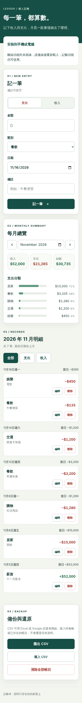

# 記帳本

個人記帳網頁：記錄每日收入與支出，查看每月收入、支出、結餘與支出分類比例。可安裝到手機主畫面，離線也能記帳。

## 功能

- **記一筆**：選擇支出／收入、金額（最多兩位小數）、類別、日期與備註（可留空）。
- **每月總覽**：切換月份，查看當月收入、支出、結餘，以及各支出類別的金額與比例。
- **本月明細**：依日期分組（新的在上方），顯示每日小計；可依「全部／支出／收入」篩選，每筆可編輯或刪除（刪除前會確認）。
- **備份與還原**：匯出 CSV（含 BOM，Excel 可直接開啟中文）；匯入 CSV 時依「編號」欄略過已存在的帳目，不會覆蓋現有資料。清除全部帳目前會再次確認。

類別：支出為餐飲、交通、購物、居家、娛樂、醫療、教育、其他；收入為薪資、獎金、投資、兼職、其他。

## 資料儲存

帳目只存在目前裝置瀏覽器的 `localStorage`（鍵名 `ledger-records-v1`），**不會上傳到任何伺服器**，也不需要帳號。因此：

- 不同裝置、不同瀏覽器之間資料不會同步。
- 清除瀏覽器網站資料、無痕模式關閉後，帳目會消失；請定期「匯出 CSV」備份，換裝置時再匯入。
- 瀏覽器無法儲存時，頁面會顯示黃色提示。

## 本機預覽與部署

不需建置。本機預覽需要 Python 3：在根目錄執行 `python -m http.server 8000`，再開啟 `http://localhost:8000`。

GitHub Pages 請在 Settings → Pages 選擇 Deploy from a branch、`main`、`/ (root)`。預期網址為 https://love732174-star.github.io/AnitaHuang/ 。

## PWA 安裝與離線使用

- Android／電腦 Chrome：使用頁面上的「安裝記帳本」（瀏覽器提供安裝提示時顯示），或選單的「安裝應用程式／加入主畫面」。
- iPhone／iPad：用 Safari 開啟，選「分享 → 加入主畫面」。
- 首次需連線開啟並完成 Service Worker 快取，之後可離線開啟並記帳。
- 有新版本時顯示「更新版本」，點選後重新載入；已儲存的帳目不受影響，只有表單中尚未記下的內容會清除（會先確認）。
- 修改快取的靜態檔案時，須一併遞增 `sw.js` 的 `CACHE_NAME` 版本（目前 `v1`）。新版啟用時也會清除舊版報修網頁留下的快取。

## 驗證

- 語法檢查（Node.js）：`node --check app.js`、`node --check pwa.js`、`node --check sw.js`
- 瀏覽器測試需要 Python 3、Playwright（`pip install playwright`）與 Chromium（系統 `chromium`、`python -m playwright install chromium`，或以環境變數 `CHROMIUM_PATH` 指定執行檔）。兩支測試都會自行啟動測試伺服器：
  - `python tests/browser_check.py`：驗證、新增／編輯／刪除、重新載入後保存、每月統計與分類、篩選、月份切換、文字安全、CSV 匯出匯入與去重、損壞資料容錯、手機寬度；截圖輸出到 `tests/output/`（已加入 `.gitignore`）。
  - `python tests/pwa_check.py`：安裝條件、GitHub Pages 子路徑、圖示、快取範圍、舊快取清除、無外部請求、離線記帳與重開、更新確認。

## 舊報修系統文件

本專案原為報修登記系統，網頁已改為記帳本。`文件/` 內的報修欄位表、操作說明與提案簡報為舊專案資料，保留供參考：
[報修欄位表](文件/報修欄位表.xlsx) · [報修系統操作說明](文件/報修系統操作說明.docx) · [報修登記系統提案](文件/報修登記系統提案.pptx)
